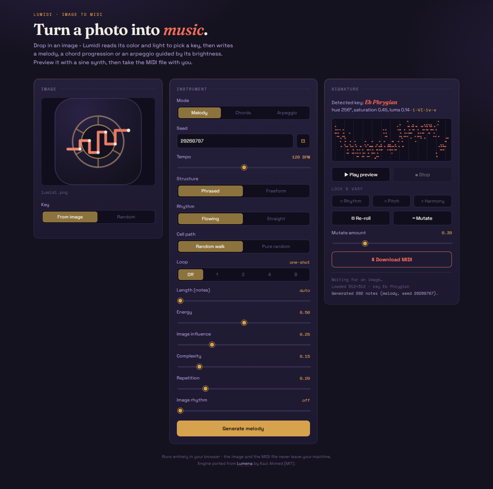

  

# LUMIDI

**Image to MIDI, right in your browser.**

Lumidi reads an image's colour and light, picks a musical key from it, and writes a melody, a chord progression or an arpeggio guided by the image's brightness. You can preview the result with a built-in sine synth and download it as a standard MIDI file for any DAW. Plain HTML, CSS and JavaScript with no dependencies or build step.

Everything runs client-side: the image and the MIDI file never leave your machine.

**Live:** https://theogal.github.io/lumidi/

**Disclaimer:** Im into web developing but this app was entirely vibe-coded with Claude

### Screenshot

  

## Inspired by Lumena

Lumidi is a browser app inspired by **[Lumena](https://github.com/pixelsncodes/lumena)** by Kazi Ahmed, a C++ library that turns images into MIDI melodies and is designed to be embedded in a JUCE synth plugin.

## How it works

1. **Measure the image.** The image is divided into a 16 × 12 grid and the average brightness of each cell is measured (Rec. 709 luma), then stretched to fill the 0-1 range. Across the whole image, Lumidi also takes a saturation-weighted average hue, plus the average saturation and brightness.
2. **Pick a key.** The average hue chooses a root on the circle of fifths. Saturation and brightness choose the scale type:
   - washed-out images get pentatonic scales
   - vivid, dark images get blues or harmonic minor
   - everything else gets a mode, from Phrygian (dark) through Lydian (bright)
   - near-grey images fall back to A minor pentatonic
3. **Walk the image.** A first-order Markov chain over scale degrees picks the notes. It prefers stepwise motion, pulls gently toward the tonic and the middle of the range, resolves leaps, and avoids repeating the same note three times. At each step it is nudged toward the pitch the current cell's brightness suggests.
4. **Shape it.** In Phrased mode the notes become a short motif and its variations, contrasting phrases and a closing cadence. They follow a chord progression and one of three rhythm grooves, rise and fall in volume within each phrase, and are kept in a consistent register.
5. **Export.** The notes are written as a format-0 Standard MIDI File with the chosen tempo.

A given image, settings and seed always produce exactly the same result.

## Features

**Modes**
- **Melody**
  - *Phrased*: motif, variations, contrasting phrases and a final cadence, over a pop chord progression.
  - *Freeform*: one continuous walk with no phrase structure.
- **Chords**: a progression of voice-led triads or seventh chords.
- **Arpeggio**: chord tones in five patterns (up, down, up-down, converge, random), spread over 1-3 octaves, in eighths or sixteenths, with swing.

**Controls**

| Control | What it does |
|---|---|
| Key | Detect the key from the image, or pick one at random from a 12-scale library |
| Seed | Makes results reproducible; the dice button rolls a new one |
| Tempo | 40-200 BPM, used for the preview and written into the MIDI file |
| Rhythm | *Flowing* lets brightness shape note lengths; *Straight* uses steady quarter notes |
| Cell path | *Random walk* moves to a neighbouring cell each step; *Pure random* jumps anywhere |
| Loop | 1, 2, 4 or 8 bars: the result fills whole bars and loops seamlessly |
| Length | Target note or chord count (*auto* is one per grid cell) |
| Energy | Overall loudness, how much space between phrases, and chords per bar |
| Image influence | How strongly brightness steers the pitch, compared with smooth stepwise motion |
| Complexity | How often arpeggio flourishes and occasional leaps appear |
| Repetition | How often the motif comes back unchanged rather than varied |
| Image rhythm | Busy, high-contrast parts of the image get more, shorter notes |

**Lock & vary**
- **Lock rhythm / pitch / harmony** keeps those parts of the current result when you generate again.
- **Re-roll** picks a new seed and regenerates, keeping whatever is locked.
- **Mutate** nudges a share of the notes (set by *Mutate amount*) without regenerating.

## Hosting it

Lumidi is a static site with no build step or dependencies. Serve the folder from any web server.

To deploy, copy the folder to any static host or web server. The only external request is to Google Fonts; without it, the page falls back to system fonts.

## Differences from Lumena

- **Different random generator.** Lumidi uses mulberry32 instead of `std::mt19937`, so a seed is reproducible within Lumidi but gives a different result than the same seed in a native Lumena build.
- **Preview synth only.** Lumena is meant to drive a JUCE plugin's instrument; Lumidi previews with a simple sine synth and leaves real sound design to your DAW.
- **No diagnostics or metrics.** Lumena's measurement tools and debug tracks aren't ported.

## Credits

- Original engine and design: [Lumena](https://github.com/pixelsncodes/lumena) by Kazi Ahmed, MIT License.
- Browser app: Lumidi.

## License 
MIT - do what you want with it
